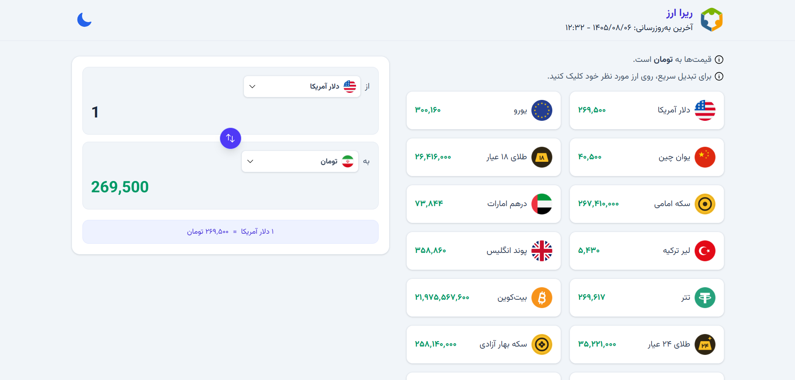
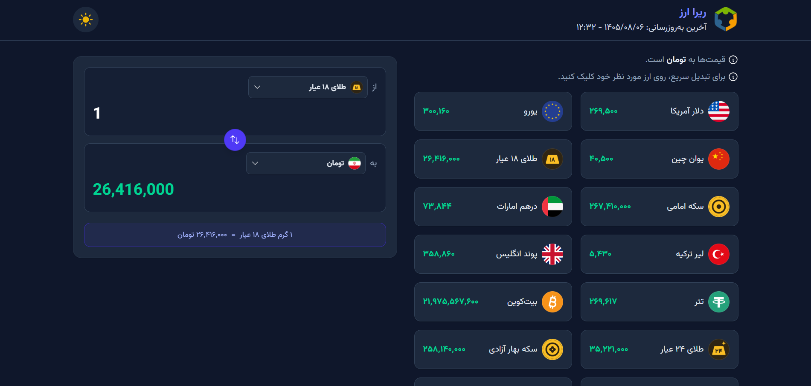
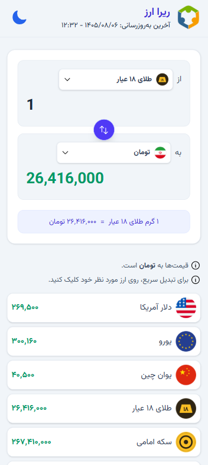
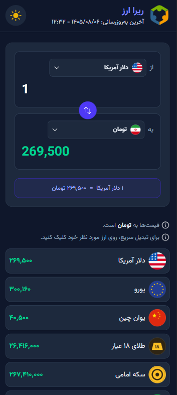

<div align="center">
  

  <h1>💱 RIRA Currency | ریرا ارز</h1>
  
  <p><strong>Real-Time Currency Converter & Rates Dashboard</strong></p>
  
  <a href="https://rira-currency.vercel.app" target="_blank">
    
  </a>
</div>

---

<div align="center">
  
  
  
  
</div>


---

## 📖 About The Project

>This project is a **Frontend Trainee Task** for **RIRA**. 

As requested in the task, the goal was to build a **simple currency converter** .

*   **Tech Stack:** Built with React, TypeScript, and Tailwind CSS for styling.
*   **Clean Architecture:** Separating business logic into custom hooks (`useRates`, `useConverter`, `useTheme`) to keep UI components clean and focused.
*   **Type Safety:** Using TypeScript with strict typing (e.g., `keyof Rates`) to prevent runtime errors.
*   **Connecting to API:** Fetching live rates from the provided endpoint. Facing CORS restrictions was a challenge. I resolved this by using a **Vite Proxy** in development and **Vercel Rewrites** in production. *(Note: The API provides live data approximately from 11:00 AM to 8:00 PM Tehran Time).*
*   **User Experience:** Fully responsive design (mobile-first). The app includes a Dark/Light theme toggle, custom dropdowns displaying currency logos, and smart number formatting for better readability.

---

## 🎯 How It Works

The app is a single-page dashboard with two main parts: a **Converter** and a **Price List**.

*   **Converter:** Managed by the `useConverter` hook, it handles two-way conversion, currency selection, and the swap button. It uses utility functions to format numbers (with commas) and prevent invalid inputs like `NaN`.
*   **Price List:** Displays the real-time rates. Clicking on any currency card automatically sets it as the source currency, sets Toman as the target, and fills the input with `1` for a quick preview.
*   **Data:** The `useRates` hook fetches the live data. Since the API doesn't return Toman (IR), it's manually added with a value of `1` to serve as the base.

---

## 🚀 Getting Started

Follow these steps to run the project locally:

1. **Clone the repository:**
   ```bash
   git clone https://github.com/alisadeghi192/rira-currency.git
   ```

2. **Navigate to the project directory:**
   ```bash
   cd rira-currency
   ```

3. **Install dependencies:**
   ```bash
   npm install
   ```

4. **Run the development server:**
   ```bash
   npm run dev
   ```

5. **Open the app:**
   Open [http://localhost:5173](http://localhost:5173) in your browser.

   ---

   ## 🖼️ Screenshots

| Desktop (Light) | Desktop (Dark) |
|:---:|:---:|
|  |  |

| Mobile (Light) | Mobile (Dark) |
|:---:|:---:|
|  |  |

> 🌗 The app supports both Dark & Light modes with a fully responsive layout.

---

## 📁 Project Structure

```plaintext
rira-currency/
├── public/                 # Static assets (logo, currency icons, fonts)
├── screenshots/            # README screenshots
├── src/
│   ├── components/         # UI Components (Header, Converter, PriceList, etc.)
│   ├── constants/          # Currency names and units
│   ├── hooks/              # Custom Hooks (useRates, useConverter, useTheme)
│   ├── types/              # TypeScript interfaces
│   ├── utils/              # Helper functions (formatting, parsing)
│   ├── App.tsx             # Main App component
│   ├── index.css           # Tailwind + global styles
│   └── main.tsx            # Entry point
├── vercel.json             # API proxy for production
└── vite.config.ts          # Vite config + API proxy for development
```

---

## 📬 Contact


**Ali Sadeghi**  
📧 [aliisadeghii192@gmail.com](mailto:aliisadeghii192@gmail.com)  
📱 [+98 991 20 32 109](tel:+989912032109)  
💬 [Telegram](https://t.me/alisadeghi_dev) <br>
📷 [Instagram](https://instagram.com/alisadeghi_dev)  
🔗 [GitHub](https://github.com/alisadeghi192) <br>
🔗 [LinkedIn](https://www.linkedin.com/in/alisadeghi19211/)

---
Made with ❤️ for the RIRA Frontend Trainee Task.